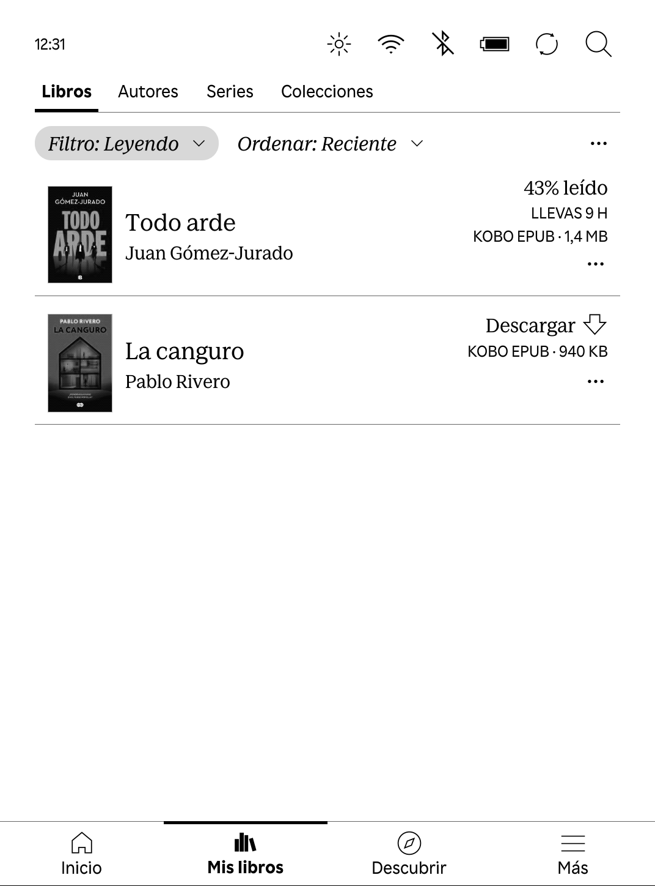

# Kobo reading-time patch

*[Versión en español más abajo](#español)*

On the home-screen book card and in the library list, Kobo shows how much time is **left** to finish a book ("8 hours to go"). This patch makes it show how much time you have **already spent** reading it ("9h 39m read") instead. Kobo already records that time for every book; it just doesn't display it there.



## Compatibility

| Device | Firmware | `libnickel.so.1.0.0` MD5 |
|---|---|---|
| Kobo Clara BW | 4.46.23852 | `ff0d6f9cba0ff963a71cc98384089070` |

The script checks this hash and refuses to write anything for any other version. A Kobo firmware update replaces the patched file, so the patch disappears and has to be regenerated for the new version.

## What it changes

Only `libnickel.so.1.0.0`, and only these two screens. Reading stats and the in-book footer are unchanged.

1. `SingleBookHomeWidget::setContent` and `DragonListWidget::setContent` read `TimeSpentReading` (`Volume` d+`0x16c`) instead of `RestOfBookEstimate` (d+`0x170`).
2. `readingTimeLeft()` always takes the "hours + minutes" branch, which Kobo normally uses only for audiobooks.
3. The new texts are written into unused padding at the end of the first `PT_LOAD` segment, and only `readingTimeLeft()` is pointed at them. The original strings, which other screens also use, are left untouched.

## Languages

Kobo's translations are stored compressed inside the binary, so the patch bypasses them: the text is shown exactly as written, and you choose its language when you apply the patch.

| `--lang` | Result |
|---|---|
| `es` (default) | Llevas 9 h 39 min |
| `en` | 9h 39m read |
| `fr` | 9 h 39 min de lecture |
| `de` | 9 Std. 39 Min. gelesen |
| `it` | 9 h 39 min di lettura |
| `pt` | 9 h 39 min de leitura |
| `nl` | 9 u 39 min gelezen |

To use your own wording, pass `--text "%0h %1m read" "%n min read"`, where `%0` is hours, `%1` is minutes, and `%n` is minutes when it's under one hour. The text does not change if you later switch the Kobo's language.

## Usage

Requirements: Python 3.8+ and `pip install capstone pyelftools`.

1. Copy `/usr/local/Kobo/libnickel.so.1.0.0` from your Kobo to your computer. See [SSH-GUIDE.md](SSH-GUIDE.md); no KOReader or other mods needed.
2. Build the installer:
   ```bash
   python make_patch.py libnickel.so.1.0.0 --lang en --tgz KoboRoot.tgz
   ```
3. Copy `KoboRoot.tgz` to the `.kobo` folder on the Kobo and reboot. Kobo checks the archive, installs it, and then deletes it.
4. Optional: over SSH, run `md5sum /usr/local/Kobo/libnickel.so.1.0.0` and compare the result with the "Patched MD5" the script printed.

**To undo it:** keep the original `libnickel.so.1.0.0` you copied in step 1, then run:
```bash
python make_patch.py libnickel.so.1.0.0 --restore --tgz KoboRoot.tgz
```
and install that `KoboRoot.tgz` the same way.

## Status and caveats

- Tested on a real Kobo Clara BW (4.46.23852) with `--lang es`. The other languages build and pass the same checks, but nobody has seen them on a device yet.
- The non-Spanish texts were not reviewed by native speakers, so corrections are welcome. Texts with non-ASCII characters have not been tested.
- Audiobooks also show "read" time (time listened).
- [reading-time-es.kobopatch.yaml](reading-time-es.kobopatch.yaml) describes the same changes (Spanish texts only) in kobopatch format. It has **not** been tested with kobopatch.
- Modifying system files can leave the device unable to boot. Back up your Kobo first. Use at your own risk.

## Not included

This repository contains no Kobo binaries. You patch your own copy of `libnickel`.

## Acknowledgements

- The patch format follows [kobopatch](https://github.com/pgaskin/kobopatch) by pgaskin.
- Inspired by [kobopatch-webui](https://github.com/nicoverbruggen/kobopatch-webui) by nicoverbruggen.

## License

[MIT](LICENSE). This license covers the script and documentation in this repository only. Kobo's software is not included, and it remains Kobo's.

---

# Español

En la ficha del libro de la pantalla de inicio y en la lista de la biblioteca, Kobo muestra el tiempo que **queda** para terminar un libro («Quedan 8 horas»). Este parche hace que muestre en su lugar el tiempo que **llevas** leyéndolo («Llevas 9 h 39 min»). Kobo ya guarda ese dato para cada libro; solo que no lo enseña ahí.

## Compatibilidad

| Aparato | Firmware | MD5 de `libnickel.so.1.0.0` |
|---|---|---|
| Kobo Clara BW | 4.46.23852 | `ff0d6f9cba0ff963a71cc98384089070` |

El script comprueba esta huella y no escribe nada si la versión es otra. Una actualización del firmware de Kobo sustituye el archivo parcheado, así que el parche desaparece y hay que generarlo de nuevo para la nueva versión.

## Qué cambia

Solo `libnickel.so.1.0.0`, y solo esas dos pantallas. Las estadísticas de lectura y el pie de página dentro del libro no cambian.

1. `SingleBookHomeWidget::setContent` y `DragonListWidget::setContent` leen `TimeSpentReading` (`Volume` d+`0x16c`) en lugar de `RestOfBookEstimate` (d+`0x170`).
2. `readingTimeLeft()` usa siempre el formato de «horas + minutos», que Kobo normalmente solo usa con los audiolibros.
3. Los textos nuevos se escriben en un hueco libre al final del primer segmento `PT_LOAD`, y solo `readingTimeLeft()` apunta a ellos. Los textos originales, que también usan otras pantallas, quedan intactos.

## Idiomas

Las traducciones de Kobo van comprimidas dentro del programa, así que el parche no las usa: el texto se ve tal como se escribe, y el idioma se elige al aplicar el parche. Los idiomas disponibles con `--lang` son los de la tabla de arriba (`es` por defecto).

Para poner tus propios textos, usa `--text "%0 h %1 min" "%n min"`, donde `%0` son las horas, `%1` los minutos y `%n` los minutos cuando es menos de una hora. El texto no cambia si después cambias el idioma del Kobo.

## Uso

Requisitos: Python 3.8+ y `pip install capstone pyelftools`.

1. Copia `/usr/local/Kobo/libnickel.so.1.0.0` del Kobo al ordenador. Lo explica la [guía de SSH](SSH-GUIDE.md#español); no hace falta KOReader ni otros mods.
2. Genera el instalador:
   ```bash
   python make_patch.py libnickel.so.1.0.0 --lang es --tgz KoboRoot.tgz
   ```
3. Copia `KoboRoot.tgz` a la carpeta `.kobo` del Kobo y reinícialo. Kobo comprueba el archivo, lo instala y después lo borra.
4. Opcional: por SSH, ejecuta `md5sum /usr/local/Kobo/libnickel.so.1.0.0` y compara el resultado con el «Patched MD5» que mostró el script.

**Para deshacerlo:** guarda el `libnickel.so.1.0.0` original que copiaste en el paso 1 y ejecuta:
```bash
python make_patch.py libnickel.so.1.0.0 --restore --tgz KoboRoot.tgz
```
Después instala ese `KoboRoot.tgz` de la misma forma.

## Estado y avisos

- Probado en un Kobo Clara BW real (4.46.23852) con `--lang es`. Los demás idiomas se generan y pasan las mismas comprobaciones, pero nadie los ha visto todavía en un aparato.
- Los textos que no están en español no los ha revisado ningún hablante nativo, así que se agradecen las correcciones. Los textos con caracteres no ASCII no se han probado.
- Con audiolibros también muestra el tiempo «llevado» (tiempo escuchado).
- [reading-time-es.kobopatch.yaml](reading-time-es.kobopatch.yaml) describe los mismos cambios (solo con los textos en español) en formato kobopatch. **No** se ha probado con kobopatch.
- Modificar archivos del sistema puede dejar el aparato sin arrancar. Haz antes una copia de seguridad del Kobo. Úsalo bajo tu responsabilidad.

## Qué no incluye

Este repositorio no contiene ningún programa de Kobo. Cada persona parchea su propia copia de `libnickel`.

## Agradecimientos

- El formato del parche sigue el de [kobopatch](https://github.com/pgaskin/kobopatch), de pgaskin.
- Inspirado en [kobopatch-webui](https://github.com/nicoverbruggen/kobopatch-webui), de nicoverbruggen.

## Licencia

[MIT](LICENSE). La licencia cubre solo el script y la documentación de este repositorio. El software de Kobo no está incluido y sigue siendo de Kobo.
